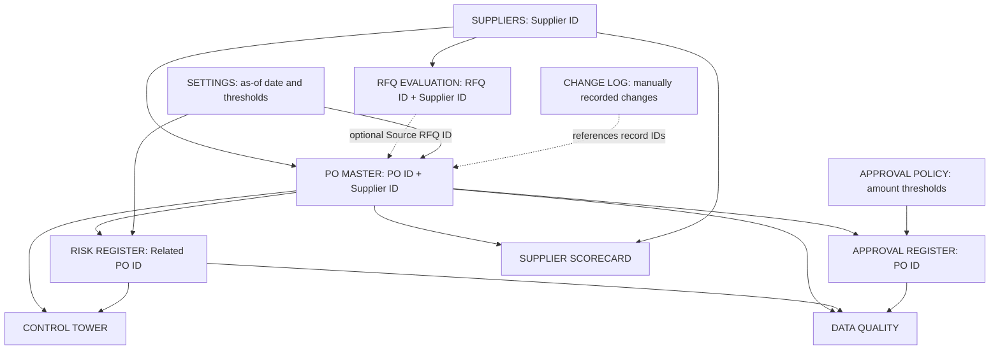

EVOF — Procurement Operations Framework
System Architecture, Data Model, Business Rules & Governance
Document status: Portfolio technical documentation | Version: 1.0 | Date: 2026-10-15
Implementation baseline: EVOF_Integrated_Procurement_Governance_Controls.xlsx
Classification: Public demonstration; all example data is fictional.
Maturity: Excel-based conceptual prototype, not a deployed ERP, transactional application, or production control environment.
1. Purpose and scope
EVOF is an independent framework illustrating how Procurement, Inventory-related supply visibility, Finance, Engineering and Project Operations can share procurement information. The current implementation demonstrates supplier master data, RFQ evaluation, purchase-order tracking, supply risk management, approval review, manual change documentation, data-quality checks, and operational reporting.
The workbook is a single-file prototype. Its shared identifiers and formula-based reporting reduce duplicated data entry, but do not constitute a relational database, integrated ERP, or automated workflow engine.
In scope
- Maintain a supplier reference list.
- Compare supplier quotations for an RFQ.
- Track purchase-order quantities, amounts, revised delivery estimates and follow-up actions.
- Register risks linked to purchase orders.
- Calculate summary metrics and supplier-level exposure.
- Evaluate whether documented approvals satisfy illustrative authority rules.
- Record changes manually and surface selected data-quality exceptions.
Out of scope
Actual purchase-order transmission; invoice matching and payments; inventory transaction posting; user authentication; role-based access control; immutable audit logging; automated email alerts; ERP/MRP synchronization; real-time logistics feeds; and production-grade authorization enforcement.
2. Workbook architecture
Layer	Worksheet	Responsibility	Source of truth?
Reference data	SUPPLIERS	Supplier IDs, names, categories, country, status	Yes, supplier identity
Transactional analysis	RFQ EVALUATION	RFQ quotations and scoring inputs/results	Yes, RFQ example
Operational transactions	PO MASTER	PO identifiers, suppliers, amounts, quantities, dates and actions	Yes, PO tracking
Risk management	RISK REGISTER	Risk assessment, mitigation, owner, action dates	Yes, risk records
Authorization policy	APPROVAL POLICY	Illustrative amount bands and required approval roles	Yes, approval thresholds
Authorization evidence	APPROVAL REGISTER	Approval decisions, signatories and release eligibility	Yes, recorded approval status
Change evidence	CHANGE LOG	Manually entered before/after change records	Yes, only for entries actually logged
Configuration	SETTINGS	Analysis date, alert window, risk thresholds, currency	Yes, parameters
Reporting	CONTROL TOWER	Aggregate operational KPIs	No, derived
Reporting	SUPPLIER SCORECARD	Supplier-specific PO counts and exposure	No, derived
Data assurance	DATA QUALITY	Selected automated exception counts	No, derived
Governance reference	GOVERNANCE RULES	Control definitions, owners, cadence, limitations	Policy reference
User guidance	START HERE	Workbook orientation	Documentation

Logical data flow

Dotted arrows represent optional or documentary relationships, not automatically enforced foreign keys.
3. Data entities and relationships
Entity	Business identifier	Key fields	Relationship / cardinality	Current enforcement
Supplier	Supplier ID (SUPPLIERS!A)	Name, category, country, status	One supplier to many RFQ quotation rows and POs	PO supplier existence checked by formula; not database-enforced
RFQ quotation	RFQ ID + Supplier ID conceptually	Item, price, quantity, freight, duties, lead time, quality, terms, risk	One RFQ can have many supplier offers	Combination uniqueness not automatically validated
Purchase order	PO ID (PO MASTER!A)	Supplier ID, project/cost center, dates, quantities, unit price, status	One PO to many risks; one PO may have approval records	Duplicate PO check; some supplier/RFQ checks
Supply risk	Risk ID (RISK REGISTER!A)	Related PO ID, likelihood, impact, mitigation, owner	Many risks to one PO	Invalid PO references checked
Approval	Approval ID (APPROVAL REGISTER!A)	PO ID, approvers, decisions, dates, release gate	Potentially many approval records to a PO; prototype prepopulates one per example PO	Formula checks and advisory release gate
Change record	Change ID (CHANGE LOG!A)	Record type/ID, old/new values, actor, reviewer, evidence	Many changes may refer to one business record	Manual log and completeness check, not immutable

Important distinction: A shared ID is a design convention; the workbook does not provide a database's referential constraints, transaction isolation, or concurrent editing guarantees.
Example IDs
- Suppliers: SUP-A, SUP-B, SUP-C.
- RFQ: RFQ-001, with three quotations for industrial pneumatic actuators.
- POs: PO-26001 onward; ten example orders for various industrial items.
- Risks: R-001 onward, associated with PO IDs.
No fabricated procurement lineage: RFQ-001 is an independent demonstration. The sample POs are not presented as orders awarded from that RFQ. PO MASTER!W (Source RFQ ID) is available for future legitimate links.
4. Field definitions and calculations
PO MASTER
Field	Column	Definition / logic
PO ID	A	Unique business reference; duplicates flagged in DATA QUALITY
Supplier ID	B	Reference to SUPPLIERS!A
PO Date	F	Date order was issued/recorded
Original Due	G	Initial committed delivery date
Revised ETA	H	Current expected delivery date
Ordered Qty / Received Qty	I / J	Quantity ordered and quantity received
Unit Price USD	K	Unit purchase price, not landed cost
PO Value USD	L	Ordered Qty × Unit Price
Open Qty	M	MAX(0, Ordered Qty − Received Qty)
Open Value USD	N	Open Qty × Unit Price
Days to ETA	O	Revised ETA − SETTINGS!B4 for open POs
Days Late	P	Known defect: existing formula uses SETTINGS!B4 − PO Date, not delivery due date; do not use as a delay metric
PO Status	Q	Derived as Received, Partially Received or Open from quantities
Delivery Risk	R	Closed if fully received; High if revised ETA before analysis date; Watch if ETA within watch window; otherwise Normal
Source RFQ ID	W	Optional link to RFQ; existence checked if supplied
Data Quality	X	Flags unknown supplier or unknown referenced RFQ; otherwise OK

Recommended correction (not yet applied to baseline workbook): Define overdue days against Original Due (G) or Revised ETA (H), depending on the intended KPI. For example, days overdue against current ETA on an open PO: =IF(M4=0,0,MAX(0,SETTINGS!$B$4-H4)). Separately calculate schedule slippage as MAX(0,H4-G4). These are different measures and should not be conflated.
RISK REGISTER
- Risk Score = Likelihood (1–5) × Impact (1–5).
- Priority is derived from thresholds in SETTINGS (High 12; Critical 16 in the example).
- Risk records contain mitigation, next action, owner, due date, status and last-review date.
- A risk's priority is a subjective assessment; it is not a validated statistical probability of loss.
RFQ EVALUATION
- Landed cost combines unit price × quantity, freight and duties.
- Comparison also uses lead time, quality, payment terms and risk inputs.
- Scoring is a decision-support model, not a replacement for technical qualification, contractual review or supplier due diligence.
5. Business rules
ID	Rule	Implementation / observation
BR-01	Each PO should have a unique PO ID.	Duplicate PO count in DATA QUALITY.
BR-02	PO supplier must exist in supplier master.	PO MASTER!X and aggregate quality check.
BR-03	Optional source RFQ must refer to an existing RFQ.	PO MASTER!X checks existence when field W is populated.
BR-04	Open quantity cannot be negative in reported metrics.	Formula uses MAX(0, ordered − received); this can mask over-receipt rather than flag it.
BR-05	Open exposure is open quantity multiplied by unit price.	Formula-derived; excludes freight, taxes, currency variation and commitments outside POs.
BR-06	Delivery risk uses the configurable as-of date and watch window.	PO MASTER!R references SETTINGS.
BR-07	Risks should reference valid PO IDs.	DATA QUALITY reports invalid PO links.
BR-08	Approval level depends on total PO amount in USD.	APPROVAL POLICY and APPROVAL REGISTER formulas.
BR-09	Requester must differ from approver(s).	Release eligibility logic checks segregation of duties in recorded names.
BR-10	A PO should not be released when approval gate is HOLD.	Policy only; Excel does not block external issuance.
BR-11	Material changes require old/new values, reason, actor, reviewer and evidence.	CHANGE LOG supports manual entry and completeness checks.
BR-12	Reporting should be reviewed for duplicate IDs, broken references and approval exceptions.	DATA QUALITY has selected checks, not exhaustive validation.

Illustrative approval thresholds
PO amount (USD)	Required primary role	Second approval
0–4,999.99	Procurement Manager	No
5,000–14,999.99	Operations Manager	No
15,000–49,999.99	Finance Manager	Yes; Director per policy notes
50,000+	Director	Yes; Finance per policy notes

These are fictional demonstration assumptions, not an approved corporate delegation-of-authority policy. In the current sample, approval entries are uncompleted and the ten POs are flagged as not release-eligible; existing sample PO records therefore do not demonstrate a controlled historical release process.
6. Governance operating model
Accountability	Illustrative owner	Responsibilities
Process owner	Procurement Manager	Defines buying workflow, exception escalation, and approval compliance
Supplier data steward	Procurement Data Steward	Reviews supplier identifiers, duplicates and master-data changes
Finance control owner	Finance	Defines authority thresholds and segregation-of-duties expectations
PO owner	Assigned buyer / operations owner	Maintains order quantities, dates, supplier follow-up and next actions
Risk owner	Assigned individual	Maintains mitigation, review cadence and evidence
Reporting owner	Operations / Data Steward	Reviews quality checks and KPI interpretation

Proposed operational cadence: Check PO delivery exceptions during daily operations; review open high-priority risks at least weekly; reconcile master-data and approval exceptions before formal KPI distribution; review approval limits when the organizational policy changes. These cadences are design recommendations rather than automated workbook behavior.
Change-control procedure
1. Identify the affected entity, record ID and field.
2. Document the old value, new value and reason in CHANGE LOG.
3. Identify the editor and independent reviewer; attach an evidence reference.
4. Revalidate downstream exposure, risk and approval implications.
5. Confirm the review date and disposition.
This procedure is manual. Excel users can bypass it, overwrite entries, or alter history without a tamper-proof audit trail.
7. Data quality and validation coverage
Automated checks present in baseline: duplicate PO IDs; unknown PO supplier IDs; invalid PO references in risks; PO approval release eligibility; optional RFQ existence on POs; selected manual change-log completeness conditions.
Important gaps: uniqueness for RFQ/Approval/Risk/Change IDs; completeness of mandatory fields; valid date sequences; over-receipts; authorized approver identities; supplier approval status enforcement; duplicate quotation pairs; controlled enumerations across all fields; multi-currency normalization; and immutable change capture.
The baseline dashboard displays 10 sample POs, 8 open POs, USD 55,855 open exposure, and 4 High/Critical risks as stored/cached in the workbook. These figures describe fictional scenario data, not live operations. Formula results may require recalculation when opened or edited in Excel.
8. Known limitations and interpretation risks
1. Spreadsheet platform: no transactional database, access control, authenticated users or reliable concurrent write control.
2. Approval enforcement: RELEASE ELIGIBLE / HOLD is advisory; it cannot stop external PO transmission.
3. Auditability: CHANGE LOG is manual, editable and not complete by default.
4. Incorrect lateness calculation: current PO MASTER!P uses PO date rather than delivery due date. It must be corrected before lateness reporting.
5. No actual receipt dates: cannot calculate defensible actual on-time delivery (OTD) or OTIF. Revised ETA is a forecast, not proof of delivery.
6. Partial receipts: quantity received is cumulative; no receipt-event ledger, batch history or per-delivery dates.
7. Financial scope: USD unit-price exposure is not full landed cost, invoice liability or cash forecast; no FX handling.
8. Supplier performance: the scorecard summarizes counts, exposure and risks, not independently verified supplier quality or OTD performance.
9. Approval history: ten existing sample POs and ten unapproved records are intentionally illustrative; no proof they passed release gates.
10. RFQ-to-PO lineage: source RFQ links are optional and sample orders are not derived from the example RFQ.
11. Data quality: formulas detect selected issues but do not prevent all invalid edits; some range limits are fixed.
12. Risk scoring: qualitative inputs are subjective and should be calibrated against company-specific criteria.
9. Proposed remediation backlog
Priority	Improvement	Acceptance criterion
P0	Correct Days Late logic and distinguish schedule slippage	Formula uses relevant delivery date; tests cover open/closed and past/future cases
P0	Validate over-receipt and negative/blank quantities	Explicit exception for Received Qty > Ordered Qty; no masking
P1	Add actual receipt transactions	Each receipt has date, quantity and PO ID; actual OTD can be computed
P1	Strengthen identifier and mandatory-field checks	All entity keys unique; missing mandatory fields reported
P1	Formalize approval events and approver-role validation	Approval evidence tied to PO version and authenticated authority in future application
P1	Versioned RFQ-to-PO award traceability	Awarded quote ID and price/terms captured without inventing links
P2	Implement a relational database and role-based access	Foreign keys, permissions, transactions and change history enforced
P2	Automate immutable audit events and controlled workflows	Every material edit generates a system event; release gate cannot be bypassed
P2	Integrate ERP/MRP and inventory receipts	Reconciled identifiers and monitored interface errors

10. Suggested repository organization
procurement-operations-framework/
├── README.md
├── docs/
│   └── EVOF_Architecture_Data_Governance.md
└── models/
    ├── EVOF_Supplier_Evaluation_Decision_Matrix.xlsx
    ├── EVOF_Purchase_Order_Supply_Risk_Tracker.xlsx
    ├── EVOF_Procurement_KPI_Dashboard.xlsx
    ├── EVOF_Integrated_Procurement_Data_Model.xlsx
    └── EVOF_Integrated_Procurement_Governance_Controls.xlsx
The latest governance workbook is the primary reference implementation; earlier workbooks document the evolution of the concept and should not be described as automatically synchronized.
11. Portfolio statement
EVOF demonstrates process mapping, supplier and PO data modeling, formula-based operational reporting, risk-based decision support, and governance-control design. It is an independent conceptual project with fictional data, not a claimed production deployment or an employer's proprietary system.
