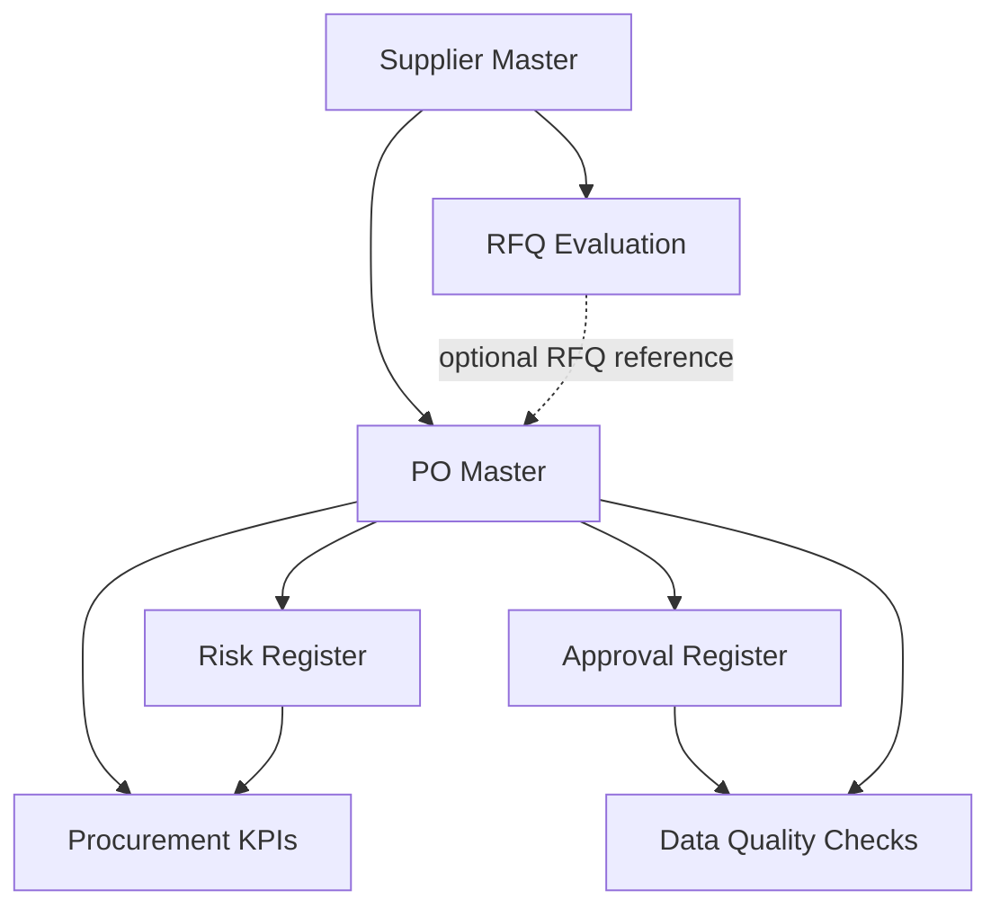

# EVOF — Procurement Operations Framework

**Independent Portfolio Project | Procurement · Supply Chain · Operations Improvement · Data Governance**

## Current MRP/project-cost checkpoint — 26 October 2026

The [v0.4.2 corrective workbook](workbooks/EVOF_MRP_Project_Cost_Decision_v0_4_2_2026-10-26.xlsx) fixes missing-date, missing-cost, missing-baseline and candidate-selection defects. It retains the bounded synthetic-data scope. Nine date cells now share yyyy-mm-dd formatting.

| Evidence | Result and limit |
|---|---|
| [Local regression](validation/EVOF_v0_4_2_Local_Checks_2026-10-26.json) | **51/51 PASS**, rerun on the exact final workbook; not Excel desktop evidence |
| [Excel 365 session, 26 October](docs/EVOF_Excel365_Validation_Status_2026-10-26.md) | Seven positive user reports: **six case confirmations plus one setup-qualified result** requiring reconfirmation of both eligible alternatives |
| Private simulator 1.0 | Separate historical 38-case evidence; no simulator implementation changed in this publication |

**[Sprint closeout](docs/EVOF_Sprint_Closeout_2026-10-26.md)** · **[Corrections](docs/EVOF_v0_4_2_Corrections_2026-10-25.md)** · **[Bounded simulator alignment](docs/EVOF_Simulator_Alignment_2026-10-26.md)** · **[Artifact fingerprints](docs/EVOF_Artifact_Manifest_2026-10-26.json)**.

The sprint execution is closed with acceptance reservations. The workbook's B23 committed-material field is not connected to its calculations; no general prevention of cost double counting is claimed. Reconfirm the desktop lower-cost comparison with both options eligible. The model is ready to start bounded simulator alignment, not to claim that alignment is complete or that the full EVOF v2.0 architecture is implemented. Earlier binaries and dated evidence remain historical references.

## Simulator 1.0 — separate checkpoint of 22 October 2026

The private **EVOF MRP Project Cost Decision Simulator 1.0** makes MPS/BOM changes, full uncovered demand, supply evidence, delivery windows and project-budget consequences interactive. It also exposes a bounded reallocation/replenishment comparison with origin protection and proposed cost allocation.

- **[Simulator guide and rule lineage](docs/EVOF_Simulator_Guide.md)**
- **[38-case JavaScript validation record](docs/EVOF_Simulator_Validation_2026-10-22.md)** — 38/38 PASS with scoped browser QA, not production validation.
- [Private simulator — owner account required](https://evof-decision-simulator.humblerobin2048.chatgpt.site).
- Workbook evidence: 13/13 prior local coverage checks and [7/7 Excel 365 checks reported by the user](docs/EVOF_Excel365_Validation_Status_2026-10-21.md).

Default demand is 135 pieces, with 30 pieces left after prior consumption: **105 uncovered**, not 60. Sixty is the residual only after 45 pieces of verified, documented, timely recovery. Default expedite is USD 6,310 and the modeled project forecast is USD 26,310 against USD 25,000 budget. Estimated delivery, confirmation, budget authorization and human approval remain distinct.

The simulator is owner-private; this repository publishes its documentation, not its source or assets. Its disclosed MOQ/capacity, calendar-window and cost-allocation controls are prototype extensions for functional review. This update changes no workbook binary and does not complete the full v2.0 architecture, real ERP integration, BUD integration or agent orchestration.

## Project Overview

> **Architecture update (2026-10-16):** [EVOF Functional Scope v2.0](docs/EVOF_Functional_Scope_v2_0.md) defines EVOF as an ERP-data-informed, cross-functional decision-support framework—not a transactional ERP replacement. The Excel v1.1 workbooks remain historical prototypes; ERP integration and the complete v2.0 architecture remain unimplemented. The bounded MRP v0.4.2 corrective workbook and private simulator 1.0 are separate implementations described below.

EVOF is an independent procurement operations improvement initiative designed to connect Procurement, Inventory, Finance, Engineering, and Project Management through structured workflows, consistent data, and clear responsibilities.

The project explores how organizations can move from reactive purchasing decisions toward proactive planning, improved supply visibility, stronger operational controls, and data-informed decisions.

EVOF includes **historical Excel prototypes and a bounded private browser simulator with simulated data**, supported by documented business rules, data relationships, and governance principles. It has **not** been deployed in a production environment.

## Business Problem

Disconnected procurement information can create:
- Limited visibility into supplier lead times, inventory needs, and purchasing commitments.
- Inconsistent supplier evaluations and quotation comparisons.
- Late identification of supply and delivery risks.
- Weak traceability between purchase decisions, approvals, and operational outcomes.
- Duplicated records, unclear data ownership, and reactive follow-up.

## Solution Approach

EVOF demonstrates a connected procurement workflow:

1. **Supplier Evaluation:** Compare quotations using weighted criteria and landed-cost assumptions.
2. **PO & Supply Risk Tracking:** Monitor open quantities, delivery estimates, purchasing exposure, and mitigation actions.
3. **Procurement KPIs:** Translate operational records into dashboards and supplier-level indicators.
4. **Integrated Data Model:** Connect suppliers, purchase orders, risks, and reporting through shared identifiers.
5. **Governance Controls:** Document approval requirements, change history, and data-quality exceptions.

## Project Deliverables

| Deliverable | What it demonstrates | File |
|---|---|---|
| Supplier Evaluation & Decision Matrix | Weighted supplier comparison and purchasing decision support | [Excel](EVOF_Supplier_Evaluation_Decision_Matrix.xlsx) |
| Purchase Order & Supply Risk Tracker | PO monitoring, outstanding commitments, and supply risk management | [Excel](EVOF_Purchase_Order_Supply_Risk_Tracker.xlsx) |
| Procurement KPI Dashboard | Operational indicators and supplier-level reporting | [Excel](EVOF_Procurement_KPI_Dashboard.xlsx) |
| Integrated Procurement Data Model | Shared master data and linked operational records | [Excel](EVOF_Integrated_Procurement_Data_Model.xlsx) |
| Integrated Procurement Governance & Controls | Approval evaluation, manual change documentation, and data-quality controls | [Excel](EVOF_Integrated_Procurement_Governance_Controls.xlsx) |
| **Integrated Procurement — Reviewed v1.1** | Formula corrections and expanded data-quality checks; functional testing remains pending | **[Latest Excel](EVOF_Integrated_Procurement_Validated_v1_1.xlsx)** |
| Technical Validation Report v1.1 | Findings, corrections, limitations, and proposed functional tests | [Read report](EVOF_Technical_Validation_Report_v1_1.md) |

**Version guidance:** The Excel files document successive development stages. **v1.1 is the reviewed integrated-workbook track**; the separate MRP/project-cost track now uses the dated v0.4.2 corrective workbook and separate simulator 1.0. None is a production-certified system. Earlier workbooks remain available to show the project's evolution.

## EVOF v2.0 — Decision-Support Design

- [Functional Scope v2.0](docs/EVOF_Functional_Scope_v2_0.md) — purpose, system boundary, exclusions and v1.1 component disposition.
- [Information Architecture v2.0](docs/EVOF_Information_Architecture_v2_0.md) — conceptual ERP-export data contracts, join keys, lineage and quality checks.
- [Parking Lot](docs/EVOF_Parking_Lot.md) — deferred design opportunities, including cross-project reuse and inventory policy.

**Implementation status:** v2.0 remains documented architecture. The historical integrated v1.1 track and bounded MRP/project-cost v0.4.2 plus private simulator track have separate validation evidence. No connected ERP application or complete v2.0 implementation is claimed.

## Architecture & Documentation

The integrated prototype uses shared **Supplier ID** and **PO ID** references to connect procurement records and reporting.

The workbook also includes an approval policy, manual change log, and configurable reporting parameters.

**[Read the System Architecture, Data Model, Business Rules & Governance documentation](docs/EVOF_Architecture_Data_Governance.md)**

*Documentation note:* The architecture document describes the original governance-control baseline. The [v1.1 validation report](EVOF_Technical_Validation_Report_v1_1.md) records subsequent corrections and remaining testing work.

## Skills Demonstrated

**Procurement & Supply Chain:** RFQ analysis, supplier evaluation, purchasing workflows, purchase-order follow-up, supply-risk assessment.

**Operations & Process Improvement:** Cross-functional coordination, process mapping, exception management, KPI design, structured decision-making.

**Data Management & Governance:** Master-data identifiers, referential checks, approval logic, segregation-of-duties concepts, documented changes, and data-quality controls.

**Tools:** Microsoft Excel, formulas, operational templates, GitHub, and Markdown.

## Current Status & Limitations

**Status: Independent portfolio prototype — iterative development and technical review in progress.**

All suppliers, transactions, and operational scenarios are fictional. The prototype is not an ERP/MRP implementation or a live business application.

Key limitations:
- Excel-based data integration rather than a transactional database.
- Approval eligibility is advisory; it does not technically block PO issuance or authenticate approvers.
- Change history is manually maintained and is not immutable.
- No ERP integration or automated supplier updates.
- Actual receipt dates are not consistently available; verified on-time delivery performance cannot yet be calculated.
- Further functional tests are needed before treating all calculated results as validated.

See the [Technical Validation Report v1.1](EVOF_Technical_Validation_Report_v1_1.md) for the detailed findings and test plan.

## Development Roadmap

- Execute and document the remaining functional tests.
- Strengthen approval-role validation and exception handling.
- Improve data validation and record-level integrity checks.
- Add receipt-event records for defensible delivery-performance metrics.
- Explore database-backed integration and automated reporting in later iterations.

## Professional Focus

EVOF reflects experience in procurement, supplier coordination, purchasing operations, financial administration, and cross-functional process management.

Its guiding principle is to **anticipate operational risks and connect people, processes, and information before problems affect execution**.

---

*Independent portfolio project. All example data is simulated and provided for demonstration and professional development.*

## MRP Buyer / Project Cost Decision pilot (2026-10-16)

The v0.4 **synthetic-data prototype** compares waiting, expediting and alternate supply using time-phased material requirements, incremental cost, project budget impact and delivery feasibility. It is **partially validated** (13 arithmetic/static checks; 3 tests not run), **not production-ready**, and does not replace ERP/MRP approvals.

- [Decision methodology v0.4](docs/EVOF_MRP_Project_Cost_Decision_Methodology_v0_4.md)
- [Validation report v0.4](docs/EVOF_MRP_Project_Cost_Validation_v0_4.md)
- [Sprint log — 2026-10-16](docs/EVOF_Sprint_Log_2026-10-16.md)

The [v0.4 Excel workbook](EVOF_MRP_Project_Cost_Decision_v0_4.xlsx) **is committed to this repository**. Its reports document verified arithmetic, not completed end-to-end Excel recalculation or supplier feasibility testing.

**Sprint 2026-10-20:** [MRP/project-cost test plan and acceptance criteria](docs/EVOF_Sprint_Plan_2026-10-20.md). The v0.4.1 local coverage regression has since been executed (13/13 PASS); the separate integrated governance v1.1 matrix remains unexecuted. The integrated governance v1.1 functional tests remain a separate workstream.

## EVOF v0.4.1 — Coverage correction (2026-10-20)

The v0.4 regression identified **EVOF-040-01**: candidate quantity was compared with incremental BOM demand instead of the full uncovered requirement. A corrected **local v0.4.1 workbook** accounts for confirmed, timely prior recovery and prevents a partial-coverage option from appearing sufficient. **13/13 synthetic local regression checks PASS**; see [coverage regression report](docs/EVOF_v0_4_1_Coverage_Regression_Report_2026-10-20.md).

**Publication update (2026-10-21):** the corrected v0.4.1 Excel file is now [published in docs](docs/EVOF_MRP_Project_Cost_Decision_v0_4_1_Coverage_Corrected_LOCAL.xlsx). The published v0.4 workbook retains the known coverage defect and must not be treated as the corrected baseline. Seven defined Excel 365 cases were subsequently reported PASS by the user on 21 October; see the [desktop record](docs/EVOF_Excel365_Validation_Status_2026-10-21.md). Independent operational validation, supplier capacity, split deliveries and real ERP/finance reconciliation remain open. MOQ and capacity now have simulated controls only in the separate browser prototype. Sprint closed **provisionally for local prototype validation only**.

## Process documentation for future orchestration (2026-10-20)

[Process & Automation Readiness Log](docs/PROCESS_AUTOMATION_LOG.md) records process-level inputs, rules, responsibilities, outputs, validation evidence, exceptions, and possible future agent/tool orchestration. This is **documentation only**: it does not introduce AI agents, replace functional testing, or claim completed manual integration with the other project. Process records will be refined as functional sprints close.

### Corrective workbook publication — 2026-10-21

The **EVOF v0.4.1 Coverage Corrected** workbook has been uploaded to [docs/EVOF_MRP_Project_Cost_Decision_v0_4_1_Coverage_Corrected_LOCAL.xlsx](docs/EVOF_MRP_Project_Cost_Decision_v0_4_1_Coverage_Corrected_LOCAL.xlsx) (filename retains the original `_LOCAL` suffix). The original v0.4 workbook remains unchanged at repository root. See the [13-check local regression report](docs/EVOF_v0_4_1_Coverage_Regression_Report_2026-10-20.md). The 13 local checks remain separate from the [7 user-reported Excel 365 PASS results](docs/EVOF_Excel365_Validation_Status_2026-10-21.md). The desktop outcomes were not independently witnessed. No real ERP, supplier confirmation, capacity, MOQ or live finance validation is claimed.

