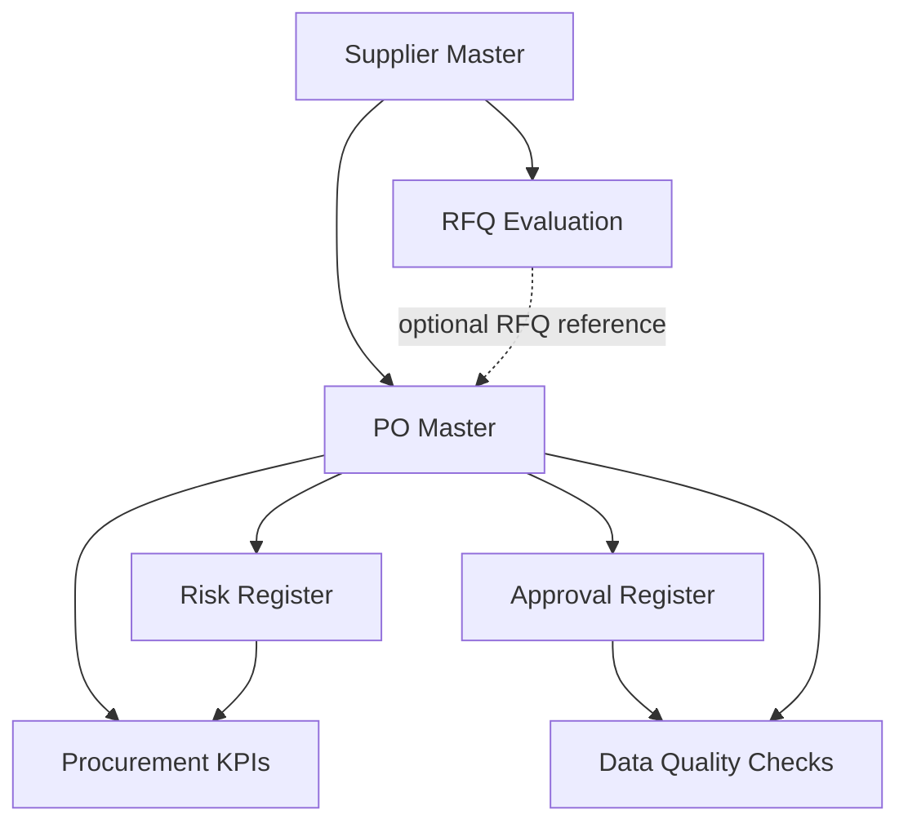

# EVOF — Procurement Operations Framework

**Independent Portfolio Project | Procurement · Supply Chain · Operations Improvement · Data Governance**

## Project Overview

> **Architecture update (2026-10-16):** [EVOF Functional Scope v2.0](docs/EVOF_Functional_Scope_v2_0.md) defines EVOF as an ERP-data-informed, cross-functional decision-support framework—not a transactional ERP replacement. The Excel v1.1 workbooks remain historical prototypes; v2.0 decision models and ERP integration are not yet implemented.

EVOF is an independent procurement operations improvement initiative designed to connect Procurement, Inventory, Finance, Engineering, and Project Management through structured workflows, consistent data, and clear responsibilities.

The project explores how organizations can move from reactive purchasing decisions toward proactive planning, improved supply visibility, stronger operational controls, and data-informed decisions.

EVOF is an **Excel-based functional prototype with simulated data**, supported by documented business rules, data relationships, and governance principles. It has **not** been deployed in a production environment.

## Business Problem

Disconnected procurement information can create:
- Limited visibility into supplier lead times, inventory needs, and purchasing commitments.
- Inconsistent supplier evaluations and quotation comparisons.
- Late identification of supply and delivery risks.
- Weak traceability between purchase decisions, approvals, and operational outcomes.
- Duplicated records, unclear data ownership, and reactive follow-up.

## Solution Approach

EVOF demonstrates a connected procurement workflow:

1. **Supplier Evaluation:** Compare quotations using weighted criteria and landed-cost assumptions.
2. **PO & Supply Risk Tracking:** Monitor open quantities, delivery estimates, purchasing exposure, and mitigation actions.
3. **Procurement KPIs:** Translate operational records into dashboards and supplier-level indicators.
4. **Integrated Data Model:** Connect suppliers, purchase orders, risks, and reporting through shared identifiers.
5. **Governance Controls:** Document approval requirements, change history, and data-quality exceptions.

## Project Deliverables

| Deliverable | What it demonstrates | File |
|---|---|---|
| Supplier Evaluation & Decision Matrix | Weighted supplier comparison and purchasing decision support | [Excel](EVOF_Supplier_Evaluation_Decision_Matrix.xlsx) |
| Purchase Order & Supply Risk Tracker | PO monitoring, outstanding commitments, and supply risk management | [Excel](EVOF_Purchase_Order_Supply_Risk_Tracker.xlsx) |
| Procurement KPI Dashboard | Operational indicators and supplier-level reporting | [Excel](EVOF_Procurement_KPI_Dashboard.xlsx) |
| Integrated Procurement Data Model | Shared master data and linked operational records | [Excel](EVOF_Integrated_Procurement_Data_Model.xlsx) |
| Integrated Procurement Governance & Controls | Approval evaluation, manual change documentation, and data-quality controls | [Excel](EVOF_Integrated_Procurement_Governance_Controls.xlsx) |
| **Integrated Procurement — Reviewed v1.1** | Formula corrections and expanded data-quality checks; functional testing remains pending | **[Latest Excel](EVOF_Integrated_Procurement_Validated_v1_1.xlsx)** |
| Technical Validation Report v1.1 | Findings, corrections, limitations, and proposed functional tests | [Read report](EVOF_Technical_Validation_Report_v1_1.md) |

**Version guidance:** The Excel files document successive development stages. **v1.1 is the latest reviewed workbook**, not a fully certified or production-ready system. Earlier workbooks remain available to show the project's evolution.

## EVOF v2.0 — Decision-Support Design

- [Functional Scope v2.0](docs/EVOF_Functional_Scope_v2_0.md) — purpose, system boundary, exclusions and v1.1 component disposition.
- [Information Architecture v2.0](docs/EVOF_Information_Architecture_v2_0.md) — conceptual ERP-export data contracts, join keys, lineage and quality checks.
- [Parking Lot](docs/EVOF_Parking_Lot.md) — deferred design opportunities, including cross-project reuse and inventory policy.

**Implementation status:** v2.0 is documented architecture, not a connected ERP application or validated decision engine. The v1.1 workbook remains the latest Excel prototype.

## Architecture & Documentation

The integrated prototype uses shared **Supplier ID** and **PO ID** references to connect procurement records and reporting.

The workbook also includes an approval policy, manual change log, and configurable reporting parameters.

**[Read the System Architecture, Data Model, Business Rules & Governance documentation](docs/EVOF_Architecture_Data_Governance.md)**

*Documentation note:* The architecture document describes the original governance-control baseline. The [v1.1 validation report](EVOF_Technical_Validation_Report_v1_1.md) records subsequent corrections and remaining testing work.

## Skills Demonstrated

**Procurement & Supply Chain:** RFQ analysis, supplier evaluation, purchasing workflows, purchase-order follow-up, supply-risk assessment.

**Operations & Process Improvement:** Cross-functional coordination, process mapping, exception management, KPI design, structured decision-making.

**Data Management & Governance:** Master-data identifiers, referential checks, approval logic, segregation-of-duties concepts, documented changes, and data-quality controls.

**Tools:** Microsoft Excel, formulas, operational templates, GitHub, and Markdown.

## Current Status & Limitations

**Status: Independent portfolio prototype — iterative development and technical review in progress.**

All suppliers, transactions, and operational scenarios are fictional. The prototype is not an ERP/MRP implementation or a live business application.

Key limitations:
- Excel-based data integration rather than a transactional database.
- Approval eligibility is advisory; it does not technically block PO issuance or authenticate approvers.
- Change history is manually maintained and is not immutable.
- No ERP integration or automated supplier updates.
- Actual receipt dates are not consistently available; verified on-time delivery performance cannot yet be calculated.
- Further functional tests are needed before treating all calculated results as validated.

See the [Technical Validation Report v1.1](EVOF_Technical_Validation_Report_v1_1.md) for the detailed findings and test plan.

## Development Roadmap

- Execute and document the remaining functional tests.
- Strengthen approval-role validation and exception handling.
- Improve data validation and record-level integrity checks.
- Add receipt-event records for defensible delivery-performance metrics.
- Explore database-backed integration and automated reporting in later iterations.

## Professional Focus

EVOF reflects experience in procurement, supplier coordination, purchasing operations, financial administration, and cross-functional process management.

Its guiding principle is to **anticipate operational risks and connect people, processes, and information before problems affect execution**.

---

*Independent portfolio project. All example data is simulated and provided for demonstration and professional development.*

## MRP Buyer / Project Cost Decision pilot (2026-10-16)

The v0.4 **synthetic-data prototype** compares waiting, expediting and alternate supply using time-phased material requirements, incremental cost, project budget impact and delivery feasibility. It is **partially validated** (13 arithmetic/static checks; 3 tests not run), **not production-ready**, and does not replace ERP/MRP approvals.

- [Decision methodology v0.4](docs/EVOF_MRP_Project_Cost_Decision_Methodology_v0_4.md)
- [Validation report v0.4](docs/EVOF_MRP_Project_Cost_Validation_v0_4.md)
- [Sprint log — 2026-10-16](docs/EVOF_Sprint_Log_2026-10-16.md)

The [v0.4 Excel workbook](EVOF_MRP_Project_Cost_Decision_v0_4.xlsx) **is committed to this repository**. Its reports document verified arithmetic, not completed end-to-end Excel recalculation or supplier feasibility testing.

**Sprint 2026-10-20:** [MRP/project-cost test plan and acceptance criteria](docs/EVOF_Sprint_Plan_2026-10-20.md). Execution remains **NOT RUN** until observed results are recorded. The integrated governance v1.1 functional tests remain a separate workstream.
