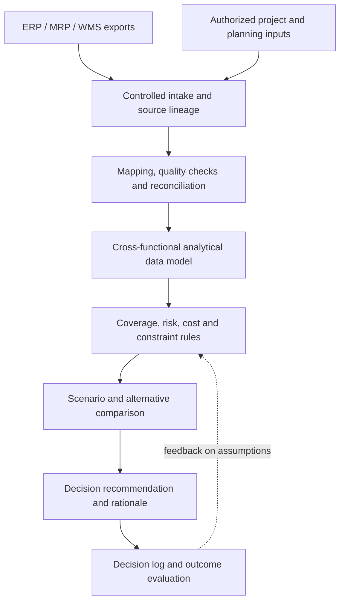

# EVOF — Functional Scope v2.0
**Date:** 2026-10-16  
**Status:** Proposed functional architecture; first sprint activity  
**Project:** Independent portfolio prototype, fictional data; not production deployed  
**Predecessor:** v1.1 Excel procurement governance and reporting prototype

## 1. Purpose
EVOF (Procurement Operations Framework) is an information-integration, data-governance and decision-support framework. It connects information generated by an ERP and other authorized business sources to support timely, traceable and cross-functional operational decisions across Procurement, Inventory, Finance, Engineering and Project Management.

The objective is **not to recreate standard ERP processes**, but to convert existing operational information into decision-relevant context: risks, alternatives, trade-offs, recommendations and subsequent outcomes.

## 2. Value proposition
ERP systems record and govern transactions; EVOF helps teams evaluate what to do next using connected evidence. EVOF aims to:
- Anticipate shortages, late deliveries and project disruption by relating inventory coverage, demand, open POs and lead times.
- Compare sourcing and mitigation alternatives against total cost, timing, operational impact and uncertainty.
- Make assumptions, source records, decision owners and results traceable.
- Improve cross-functional visibility without requiring duplicate manual entry of ERP-originated transactions.
- Support a vendor-agnostic approach: an eventual integration layer may consume controlled exports or APIs from different ERP environments.

These are design objectives, **not yet demonstrated operational outcomes**.

## 3. In scope
1. **Source intake and lineage:** ingest controlled ERP exports and supplementary authorized inputs; record extract timestamp, source system, owner, version and freshness.
2. **Information model:** join records using validated identifiers (e.g., PO ID, Supplier ID, Item ID, Project/Cost Center); document grain, keys and mapping assumptions.
3. **Data quality and reconciliation:** detect missing, duplicate, inconsistent or stale fields; reconcile source totals where possible; report exceptions without altering ERP records.
4. **Analytical rules:** derive coverage, open commitments, exposure, delivery risk, project impact and decision constraints using explicit definitions.
5. **Decision support:** compare alternatives and trade-offs; distinguish measured facts from assumptions and recommendations.
6. **Decision traceability:** record recommendation, decision maker, rationale, selected alternative and eventual result as **EVOF analytical records**, not ERP transaction history.
7. **Reporting and feedback:** present actionable indicators and compare expected vs observed outcomes when source data permits.

## 4. Out of scope
- Replacing or replicating ERP/MRP transaction processing, inventory postings, PO issuance, invoice matching or payments.
- Authenticating users, enforcing ERP role-based permissions, granting approvals or changing authoritative PO status.
- Treating a workbook-calculated release gate as an actual approval or release control.
- Maintaining duplicate authoritative supplier, inventory or PO masters when the ERP owns those records.
- Claiming live ERP integration, automatic synchronization, real-time data, predictive accuracy or production readiness in the current prototype.
- Building a full ERP as the committed project deliverable. Reuse of EVOF requirements or analytical modules in a future ERP implementation is a **possible future application**, not its present mission.

## 5. Operating boundary and ownership
| Domain | Authoritative owner | EVOF responsibility |
|---|---|---|
| PO issuance, approval, official status | ERP and authorized process owners | Consume status and relevant evidence; flag data inconsistencies |
| Inventory balances and receipts | ERP/WMS | Calculate coverage and exceptions from timestamped extracts |
| Supplier and item masters | ERP/master-data owners | Reference and validate exported IDs; enrich analytical attributes with provenance |
| Costs, commitments, financial postings | ERP/Finance | Compare cost scenarios with disclosed assumptions |
| Project demand, milestones, criticality | ERP/project systems and authorized owners | Link demand to supply and assess consequences |
| Analytical scenarios, recommendations and decision log | EVOF analytical layer / designated business owners | Maintain provenance, assumptions, alternatives and outcomes |

An exception flagged by EVOF is **not proof of an unauthorized ERP transaction**; it triggers source verification.

## 6. Logical information flow

The ERP remains authoritative for transactions. EVOF can document a recommendation or decision but cannot enact a PO status transition.

## 7. First decision use case: supply continuity
**Question:** When projected inventory coverage is shorter than the replenishment lead time, which action best balances cost, schedule and operational risk?

**Candidate inputs:** Item ID, location, available inventory, expected consumption by date, open PO quantities and ETA, supplier lead time, project requirement date, unit cost, expedite cost, alternative supplier price and qualification constraints.

**Candidate outputs:** projected coverage, shortage quantity/date, at-risk projects, options (retain schedule / expedite / alternate source), incremental cost, residual risk, recommended option and stated assumptions.

**Acceptance principle:** an auditor or reviewer can trace each calculated result to a source field or explicitly labeled assumption and reproduce the alternative ranking. No claim of a validated recommendation until scenario tests are executed.

## 8. v1.1 component disposition
| Existing asset / worksheet | Decision | v2.0 use or required change |
|---|---|---|
| SUPPLIERS | Reuse / refactor | Exported supplier reference; ERP remains master; record source and freshness |
| PO MASTER | Reuse / refactor | Read-only analytical representation of exported PO data; official PO status belongs to ERP |
| RFQ EVALUATION | Reuse / refactor | Sourcing alternatives and landed-cost assumptions; verify source and decision constraints |
| RISK REGISTER | Reuse / refactor | Analytical risk hypotheses, mitigation and ownership linked to source PO/project |
| CONTROL TOWER | Reuse / redesign | Decision-oriented alerts and exception prioritization, not only status KPIs |
| SUPPLIER SCORECARD | Reuse / refactor | Supplier performance/exposure with source definitions and completeness notes |
| DATA QUALITY | Reuse / extend | Source reconciliation, record integrity, freshness and join coverage |
| SETTINGS | Reuse / extend | As-of date, scenario assumptions, thresholds and versioned parameter definitions |
| APPROVAL POLICY | Reclassify | Reference-only policy metadata if supplied by authorized owner; not an EVOF permission engine |
| APPROVAL REGISTER | Reclassify | Optional exported approval evidence for analysis; not authoritative or actionable approval workflow |
| CHANGE LOG | Reclassify | Analytical model changes, assumptions and decision-log provenance; not ERP transaction audit log |
| GOVERNANCE RULES | Refactor | Source ownership, analytical definitions, refresh cadence, stewardship and exception handling |
| START HERE | Update later | Explain ERP/EVOF boundary and decision use case |

**Preservation rule:** keep the v1.1 workbook and technical report unchanged as historical artifacts; do not relabel their old advisory approval logic as live ERP enforcement.

## 9. Requirements for the next sprint activities
- Define the minimum export schemas, data grain, mandatory IDs, units, dates and data owners.
- Establish the supply-continuity pilot assumptions and three decision alternatives.
- Build one reproducible end-to-end example with fictional data.
- Test scenario sensitivity and quality checks; record PASS/FAIL/BLOCKED with evidence.
- Decide which v1.1 sheets should be adapted only after the pilot identifies actual data needs.

## 10. Acceptance and status
**Activity 1 deliverable:** documented purpose, scope, exclusions, value proposition, system boundary and v1.1 reuse disposition.  
**Status:** functional scope documented; stakeholder approval, ERP mappings, end-to-end decision model and functional test evidence pending.  
**Important:** this document is a proposed architecture and does not establish that an ERP export pipeline or production decision-support system exists.
