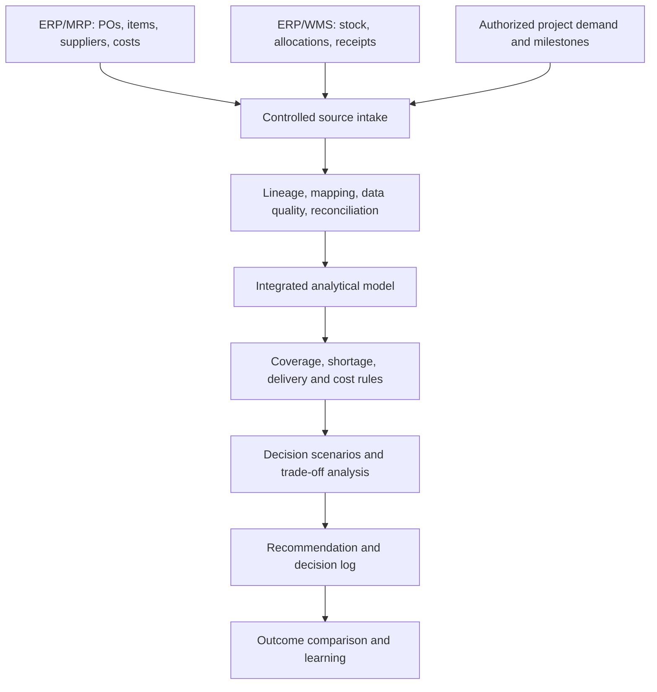

# EVOF — Information Architecture v2.0
**Date:** 2026-10-16  
**Sprint activity:** 2 — Information architecture (25 minutes planned)  
**Status:** Proposed design / not implemented  
**Related:** [Functional Scope v2.0](EVOF_Functional_Scope_v2_0.md) · [Parking Lot PL-01](EVOF_Parking_Lot.md)

## 1. Architectural principle
EVOF consumes authorized ERP/MRP/WMS exports and other approved planning inputs, checks their quality and lineage, connects them into an analytical model, and supports cross-functional decisions. It does **not** create, approve, release, post or modify ERP transactions. The ERP is the source of truth for official PO, inventory, financial and authorization states. EVOF owns only its analytical scenarios, recommendations, assumptions and decision follow-up records.

## 2. Logical data flow

## 3. Minimum conceptual source contracts
These are **proposed fields**, not verified fields from any specific ERP. Each actual connector/export requires a mapping document, extraction owner, permissions review, currency/unit conventions and quality checks.

| Dataset | Record grain / candidate key | Minimum fields | Authoritative source | Refresh / caveat |
|---|---|---|---|---|
| ITEM_MASTER | One item per legal entity/site as applicable; Item ID + site | Item ID, description, base UOM, active status, site | ERP item master | Master-data change based; IDs may not be globally unique |
| INVENTORY_SNAPSHOT | Item ID + site + location + snapshot timestamp + stock status | Item ID, site, location, on-hand, reserved/allocated, available quantity if defined, UOM, as-of timestamp | ERP/WMS | Point-in-time; do not sum different snapshots |
| OPEN_PO_LINES | PO ID + line ID + source company | PO ID, line ID, Item ID, Supplier ID, ordered qty, received qty or open qty, promised date/ETA, PO status, UOM, currency, unit price | ERP procurement | Filter canceled/closed lines according to source semantics; do not derive official status |
| PROJECT_REQUIREMENTS | Project ID + requirement line ID (or demand event ID) | Project ID, Item ID, site, required quantity, required date, priority/criticality, allocation status | ERP/MRP/project system or authorized planning file | Avoid double-counting demand already included in another forecast |
| SUPPLIER_ITEM_TERMS | Supplier ID + Item ID + effective date/site | Supplier ID, Item ID, quoted lead time, MOQ if applicable, validity date, price, currency, supplier qualification | ERP/vendor master or authorized sourcing record | Terms may be item-specific; do not use supplier-level lead time as universal |
| COST_ASSUMPTIONS | Scenario ID + cost element ID | Cost type, amount, currency, date, provenance, basis | Finance/Procurement approved inputs or explicitly labeled hypothesis | Keep actual posted costs separate from scenario estimates |
| SOURCE_MANIFEST | Extract ID | Source system, dataset, owner, extracted_at, effective_as_of, timezone, row count, checksum/file version, transformation version | EVOF ingestion metadata | Required to reproduce an analysis |
| DECISION_SCENARIOS | Scenario ID + alternative ID | As-of date, assumptions, constraints, selected alternative, estimated cost, shortage exposure, recommendation rationale | EVOF analytical records | Not ERP transactions |
| DECISION_LOG | Decision ID | Scenario ID, owner, decision date, selected option, rationale, evidence refs, outcome status | EVOF analytical records | Must not masquerade as ERP audit log |

**Deferred:** actual receipt event history, lead-time variability, supplier performance history, alternative item qualification and project BOM depth until pilot requirements establish need.

## 4. Keys, joins and cardinality
- **Item:** Use Item ID **plus site/legal entity where applicable**; do not assume global uniqueness.
- **Inventory:** Multiple location/status records per item; select a single as-of snapshot per reporting cut before aggregation.
- **PO:** One header can contain many lines. Join supply using **PO ID + line ID**, not PO ID alone.
- **Supplier:** One supplier to many PO lines; one item can have multiple suppliers. Supplier/item terms are time-bound.
- **Project demand:** One project has many requirement lines; one item may be used by many projects. Reuse is not equivalent to a confirmed quantity.
- **Allocation:** If available, use a bridge from stock/supply to project requirement to prevent the same units being promised twice.
- **Scenario:** One scenario has multiple alternatives; scenario outputs are never written back as ERP facts.

## 5. Data quality gates
| Gate | Rule | Response |
|---|---|---|
| DQ-01 | Required identifiers and date fields are present | Quarantine or flag affected analytical rows |
| DQ-02 | Key uniqueness at the declared grain | Flag duplicates; do not silently deduplicate |
| DQ-03 | Item, supplier, site and project references resolve | Flag orphan references |
| DQ-04 | Quantity/UOM and currency mappings are compatible | Block affected cost or quantity comparison until normalized |
| DQ-05 | Extraction timestamps align within defined tolerance | Mark scenario stale or noncomparable |
| DQ-06 | PO line status and quantities follow source-defined semantics | Request source reconciliation; do not change official status |
| DQ-07 | Reconcile extract row counts and selected totals to source report | Record exceptions and unresolved differences |
| DQ-08 | Demand sources and reservations do not double-count requirements | Flag overlap and disclose assumptions |

**Policy:** Quality checks may prevent publication of an EVOF recommendation, but do not block ERP transactions.

## 6. First decision-model calculations (definitions to validate)
- **Available stock:** use the ERP's documented available-to-promise definition if suitable; otherwise distinguish physical on-hand, reserved, quality-hold and available quantities explicitly.
- **Projected net position by date:** opening usable inventory + confirmed incoming supply through date − nonduplicated committed/forecast demand through date, accounting for allocations and source rules.
- **Coverage:** estimate days of usable inventory from dated consumption; do not divide by average demand when consumption is highly intermittent without noting the limitation.
- **Shortage:** first date and quantity at which projected net position becomes negative.
- **Alternative comparison:** baseline delivery, expedite, qualified alternate supplier. Compare incremental cost, date feasibility, residual shortage, project impact and constraints.
- **Decision output:** recommendation with source extract IDs, model version, assumptions, limitations and alternative ranking; a human decision owner retains accountability.

## 7. Data provenance and governance
Each analytical output should identify: source system, extract ID, effective date, transformation/model version, assumptions version, currency and UOM basis, reviewer/decision owner and evidence link. Suggested cadence for the pilot: one synchronized as-of date across simulated exports; future production refresh cadence must be approved based on business risk. No automatic integration is claimed.

## 8. Explicit boundaries and open decisions
1. No real ERP integration exists; pilot data will be fictional and shaped like controlled exports.
2. Confirm source-of-truth ownership for project requirements when ERP and planning files overlap.
3. Specify whether 'available' means on-hand minus allocations, ATP, or another ERP-specific metric.
4. Specify handling of partial receipts, split delivery schedules, overdue supply and cancelled PO lines.
5. Establish units, currency conversion dates and company/site scope.
6. Determine whether project criticality and delay cost are available from source data or scenario assumptions.
7. **PL-01 remains parked:** cross-project reuse and dynamic min/max inventory policy; the meaning of replenishment index = 2 is not yet defined.

## 9. Acceptance criteria for activity 2
- [x] Source datasets and conceptual grains/keys identified.
- [x] Logical data flow and ERP/EVOF responsibility boundary documented.
- [x] Initial joins, data-quality gates and lineage requirements documented.
- [x] Pilot calculations and unresolved data semantics listed.
- [ ] Actual ERP export schema validated.
- [ ] Sample extracts created and tested.
- [ ] End-to-end decision model executed.

**Next activity (40 minutes planned):** create the first fictional supply-continuity scenario, calculate time-phased availability, compare three options and record explicit assumptions. This document is a design deliverable, not proof of functional implementation.
